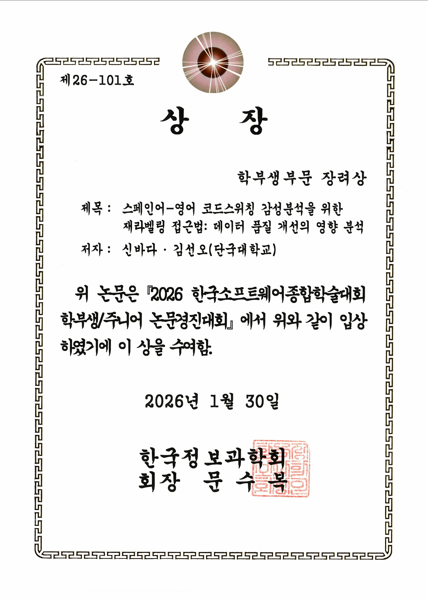

[English Version](README.md)

# Project PUENTE — 스페인어-영어 코드스위칭 감성분석을 위한 재라벨링 접근법

[](docs/paper.pdf)
[](https://huggingface.co/datasets/badashin/lince-sa-refined)
[](https://www.python.org/)
[](LICENSE)

> **"스페인어-영어 코드스위칭 감성분석을 위한 재라벨링 접근법: 데이터 품질 개선의 영향 분석"**
> KSC 2025 (한국소프트웨어종합학술대회) · 학부생논문경진대회 장려상

*PUENTE*는 스페인어로 "다리(bridge)"를 뜻합니다 — 코드스위칭 분석을 통해 언어 간의 다리를 잇는다는 의미를 담았습니다.

<p align="center">
  
</p>

## 🔍 개요

스페인어-영어 코드스위칭 감성분석의 표준 벤치마크인 LINCE SA 데이터셋에는 라벨링 오류가 존재합니다. 분석 결과 **전체 샘플의 17%가 잘못된 라벨**로 표기되어 있었습니다. 히스패닉-아메리칸 문화적 맥락에서 읽었을 때 원래 라벨이 실제 감성과 다른 경우가 대부분이었습니다.

이 프로젝트는 **데이터 중심(Data-Centric) 접근법**을 채택합니다. 더 복잡한 모델을 설계하는 대신, 라벨을 직접 검토·수정해 5,567개 규모의 Refined Dataset을 구축했고, 데이터 품질 개선만으로도 시도한 모든 아키텍처 개선보다 더 큰 성능 향상을 달성했습니다.

**핵심 기여:**
- LINCE SA 벤치마크의 17% 라벨링 오류율 발견 및 문서화
- 인간 검증 라벨을 적용한 5,567개 Refined Dataset 구축 (763개 수정)
- 데이터 정제만으로 +4.0%p 정확도 향상 — 9번의 멀티태스크 학습 실험을 모두 상회
- mBERT + XLM-R Late Fusion 앙상블로 최종 67.15% 달성 — 검증 세트 기준, [한계](#limitations) 참고

## 📊 핵심 성과

| 단계 | 모델 | 정확도 | 향상폭 |
|---|---|---|---|
| 베이스라인 | mBERT (원본 라벨) | 56.6% | — |
| 데이터 중심 | mBERT (Refined Dataset) | 60.6% | +4.0%p |
| 최종 | Late Fusion 앙상블 | **67.15%**\* | **+10.55%p** |

\* 메타러너를 같은 검증 세트로 학습하고 평가한 값입니다. 비슷한 실행으로 교차검증한 결과는
[한계](#limitations)에 있습니다.

**수치별 근거 노트북** — 노트북은 결과 출력이 남아 있는 원본 Colab 실행 기록입니다:

| 논문 수치 | 노트북 | 실험 |
|---|---|---|
| 56.6% | [`notebooks/01_baseline_mbert.ipynb`](notebooks/01_baseline_mbert.ipynb) | 실험 1 |
| 60.6% | [`notebooks/02_refined_dataset_mbert.ipynb`](notebooks/02_refined_dataset_mbert.ipynb) | 실험 11 |
| 67.15% | [`notebooks/03_late_fusion_ensemble.ipynb`](notebooks/03_late_fusion_ensemble.ipynb) | 실험 29 |

## 🗂️ 데이터셋

원본 LINCE SA 데이터셋은 Hugging Face에서 제공합니다:
[`lince-benchmark/lince` / `sa_spaeng`](https://huggingface.co/datasets/lince-benchmark/lince)

원본 텍스트는 재배포하지 않으며, 대신 다음 두 가지를 공개합니다:

- **`data/label_mapping.json`** — 수정된 763개 라벨 (`{sample_id: {original, corrected}}` 형식)
- **`data/build_refined_dataset.py`** — Hugging Face 원본 + 라벨 매핑으로 Refined Dataset 재현

**Refined Dataset 생성 방법:**
```bash
cd data
python build_refined_dataset.py
# 출력: data/refined_dataset.json (5,567개 샘플)
```

**수정 기준:**
LINCE SA는 히스패닉-아메리칸 영어에 대한 명확한 문화적 가이드라인 없이 라벨링되었습니다. 음식, 가족, 음악 등 해당 문화권에서 긍정적 의미를 갖는 스페인어 표현들이 중립이나 부정으로 분류된 사례가 많았습니다. 일관된 문화적 기준을 적용해 이를 재라벨링했습니다.

## 🏗️ 아키텍처

최종 모델은 **Late Fusion** 방식으로 mBERT와 XLM-R을 결합합니다. 두 모델을 각각 독립적으로 학습한 후, 출력 확률 분포를 이어 붙여 소규모 MLP 메타모델에 입력합니다.

```
         Refined Dataset (5,567개 샘플)
        /                              \
   mBERT                           XLM-R
(bert-base-multilingual-cased)  (xlm-roberta-base)
   + 2계층 헤드                   + 2계층 헤드
   (768 → 256 → 3)               (768 → 256 → 3)
   lr = 5e-6                      lr = 3e-5
        \                              /
         로짓 결합 (6차원 벡터)
                      |
             MLP 메타러너 (6 → 6 → 3)
                      |
                최종 예측 결과
```

**핵심 설계 인사이트:** mBERT는 의도적으로 낮은 학습률(`5e-6`)을 사용합니다. 단독 성능은 낮아지지만, XLM-R과의 예측 다양성이 높아져 앙상블 성능이 개선됩니다. 실험 30에서 확인했듯, 두 모델을 각각 최적화하면 오히려 앙상블 성능이 하락합니다.

## 🔬 실험 여정

이 결과는 5개 단계에 걸친 **34번의 체계적 실험** 끝에 도달한 것입니다.
전체 실험 기록은 [`docs/experiment_log.md`](docs/experiment_log.md)에서 확인할 수 있습니다.

| 단계 | 실험 번호 | 방향성 | 결과 |
|---|---|---|---|
| 1단계 | 실험 1 | mBERT 베이스라인 | **56.6%** — 기준점 설정 |
| 2단계 | 실험 2–9, 15–19 | 멀티태스크 학습 (하드 공유 + 어댑터) | 전부 실패 — 부정적 전이 확인 |
| 3단계 | 실험 10, 20–28 | 강화된 단일 태스크 (2계층 헤드, 튜닝) | **61.49%** 최고점 — 미미한 향상 |
| 4단계 | 실험 11–14 | 데이터 중심 전환 — Refined Dataset | **60.6%** — 모든 MTL 실험 상회 |
| 5단계 | 실험 29–34 | Late Fusion 앙상블 | **67.15%** — 최종 결과 |

**핵심 교훈:** 모델 중심 접근법(9번의 멀티태스크 실험, 10번의 아키텍처/하이퍼파라미터 실험)을 모두 시도한 후 데이터 품질 개선으로 방향을 전환했을 때 가장 큰 성능 도약(+4.0%p)이 나타났습니다. 앙상블은 그 위에서 추가 향상을 이루었습니다.

## ⚡ 재현 방법

**`notebooks/`에 있는 것:** 논문 수치를 만든 원본 Google Colab 노트북을 실행 기록으로 보존했습니다.
코드와 결과는 그대로이며, 다운로드 진행바·Drive 마운트 메시지·라이브러리 경고만 출력에서 지우고
맨 위에 영어 개요 셀을 추가했습니다. 코드 주석은 한국어입니다.

**바로 재현할 수 있는 것**

| 대상 | 방법 | GPU |
|---|---|---|
| Refined Dataset (5,567개) | `cd data && python build_refined_dataset.py` | 불필요 |
| 메타러너 재검증 (65.71%, CV, softmax 평균) | [`experiments/meta_learner_cv/`](experiments/meta_learner_cv/) 참고 | 불필요 |
| 모델 학습 (노트북 01–03) | 아래 참고 | 필요 |

**노트북을 다시 돌리려면** Colab + Google Drive 기준으로 작성되어 있어 몇 가지를 바꿔야 합니다:
- 데이터를 Google Drive 경로(`/content/drive/...`)에서 읽습니다. 로컬 경로로 바꿔 주세요.
- 노트북 01은 `lince_sa_preprocessed.json`(6,319개, 원본 라벨)을 읽는데, 이 파일은 레포에 없습니다.
- 노트북 02, 03은 `lince_sa_golden_cleaned.json`을 읽습니다. `data/build_refined_dataset.py`는
  Hugging Face에서 Refined Dataset을 만들지만, 텍스트를 `cleaned_text`가 아닌 `text` 필드에 저장합니다.
  두 파일이 완전히 같은지는 확인하지 않았습니다.
- 데이터와 시드가 같아도 GPU 연산 특성상 정확도가 ±1%p 정도 달라질 수 있습니다.

**요구 사항:** Python 3.10 이상, 모델 학습에는 CUDA GPU 필요 (원래 Google Colab Pro T4 환경에서 실행)

```bash
git clone https://github.com/vamosbada/project-puente.git
cd project-puente
pip install -r requirements.txt
cd data && python build_refined_dataset.py && cd ..
```

**기록된 학습 시간 (T4 GPU, Colab Pro):** 01 약 16분, 02 약 13분, 03의 mBERT 약 13분
(03의 XLM-R 학습 출력은 남아 있지 않습니다).

<a id="limitations"></a>
## ⚠️ 한계

- **모든 수치는 자체 검증 세트 기준입니다.** LinCE는 테스트 세트 라벨을 공개하지 않아, 이 레포의 모든 정확도는
  층화 추출한 20% 검증 세트에서 측정했고, 하이퍼파라미터도 이 검증 세트를 보고 골랐습니다.
- **67.15%는 메타러너를 학습 데이터로 평가한 값입니다.** MLP 메타러너를 검증 세트 로짓으로 학습하고 같은 세트로
  평가했습니다. 해당 실행의 로짓은 이후 실행에 덮어써져 직접 재검증할 수 없습니다.
  [`docs/experiment_log.md`](docs/experiment_log.md)에는 실험 29 설정을 재실행했을 때 67.15%가 그대로 재현됐다는
  기록이 있습니다 (같은 평가 방식 기준).
- **비슷한 실행으로 교차검증했습니다.** 실험 34(같은 구조, XLM-R lr 2e-5, 6 에포크; 원래 방식으로 65.71%)의
  저장된 로짓으로 5-fold stratified CV를 하면 65.17% ± 3.81%입니다. fold seed 5개 기준으로 원래 방식과의 차이는
  **약 0.5~1%p (0.4~1.1%p)** 입니다. 자세한 내용: [`experiments/meta_learner_cv/`](experiments/meta_learner_cv/)
- **앙상블 효과는 MLP 학습에서 나옵니다.** CV 기준으로도 앙상블은 XLM-R 단독보다 약 +1~1.5%p
  (fold seed 42 기준 +1.4%p) 높지만, 두 모델의 softmax 출력을 단순 평균하면(62.12%) XLM-R 단독(63.73%)보다 낮습니다.
- **56.6%와 60.6%는 완전히 같은 검증 세트에서 비교한 값이 아닙니다.** 정제 과정에서 중복 ID를 제거해 데이터셋
  구성이 달라졌기 때문에, 베이스라인은 검증 샘플 1,264개, Refined Dataset 실행은 1,114개를 사용했습니다.
- **검증 세트가 작습니다.** 검증 샘플이 1,114개(fold당 약 223개)라 fold 간 편차가 큽니다 (표준편차 최대 약 3.8%p).

## 📄 인용

```bibtex
@inproceedings{shin2025puente,
  title     = {스페인어-영어 코드스위칭 감성분석을 위한 재라벨링 접근법:
               데이터 품질 개선의 영향 분석},
  author    = {신바다 and 김선오},
  booktitle = {한국소프트웨어종합학술대회 (KSC 2025)},
  year      = {2025},
  note      = {학부생논문경진대회 장려상}
}
```

## 📜 라이선스

- **코드** — MIT License ([LICENSE](LICENSE) 참조)
- **데이터** — `data/label_mapping.json`의 라벨 수정본은 [CC BY 4.0](https://creativecommons.org/licenses/by/4.0/)으로 공개합니다. 원본 텍스트의 저작권은 LINCE 데이터셋 원저자에게 있으며, 사용 시 해당 라이선스를 확인하시기 바랍니다.

## 🙏 감사의 말

- 지도: 단국대학교 컴퓨터공학과 김선오 교수님
- 지원: 단국대학교 SW중심대학사업단

